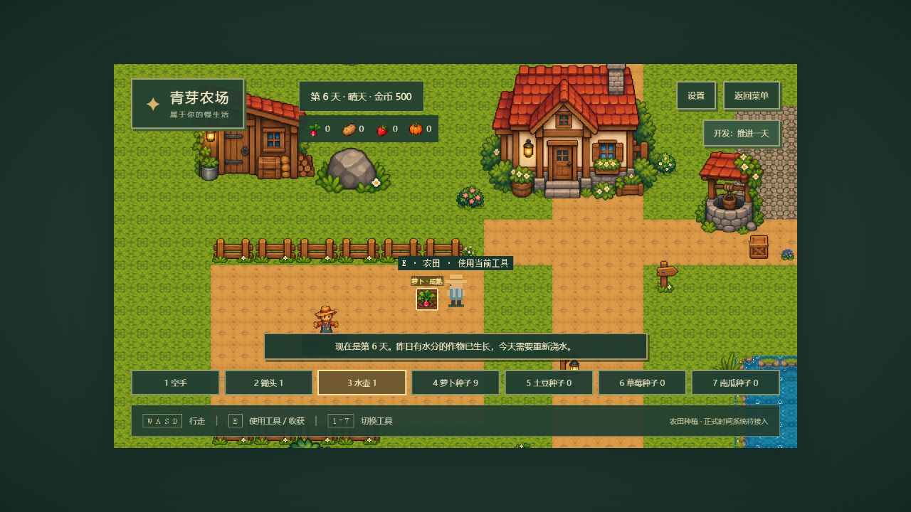

# Pixel Farm Story · 青芽农场

原创单机 2D 像素农场游戏。已实现菜单、农场与村庄探索、玩家控制、种植、24 格背包、8 格快捷栏、商店经营、时间天气、三位村民对话与委托、鸡牛养殖、网格建筑、材料采集制作、季节规则及 localStorage 存档，使用用户提供的 PNG 美术。房屋内部尚未实现。

## 运行

已在 Node.js 20.14.0、npm 10.7.0 环境验证。使用 Phaser 3、TypeScript strict、Vite 6 与 Vitest 3；精确依赖版本记录在 `package-lock.json`。

```powershell
cd D:\code\ChatGPT\1
npm ci
npm run dev
```

打开终端显示的地址，默认是 http://127.0.0.1:5173/。点击“开始游戏”进入农场。5173 已占用时开发服务器会明确退出，可用 `npm run dev -- --port 5174` 指定其他端口。

```powershell
npm run typecheck
npm test
npm run build
npm run preview -- --port 5174
```

构建结果位于 `dist/`；请通过 HTTP 服务运行，不直接双击 HTML。安装依赖后，启动不依赖任何外部图片、字体或音频 URL。

## 当前操作

- 开始游戏：创建新的内存 GameState，进入 100×70 的农场地图。
- 初始拥有锄头、水壶、10 颗萝卜种子和 500 金币。
- WASD / 方向键：四方向行走，可斜向移动；树干、木屋、围栏、水塘与地图边界有 Arcade Physics 碰撞。
- 1–8 切换快捷栏，也可点击底部工具栏。初始 1 空手、2 锄头、3 水壶、4 萝卜种子；5–8 绑定后续背包格，购买其他种子后可在背包中调整。
- B / 背包按钮：打开 24 格背包，点击查看说明；点击两格或拖动可交换、合并同类物品。选中物品再点击快捷栏绑定，或直接拖到快捷栏；快捷栏可交换绑定，也可绑定空背包格以使用空手。
- 青芽种子铺位于农田东北侧、井旁的木箱处，靠近按 E 打开。选择买卖商品、填写数量、确认交易；完成后需“继续交易”或重新选择商品才能再次交易。
- E：对面前一格农田使用当前工具；空手可收获成熟作物或观察物体。农田显示目标框，障碍所在格禁止种植。
- 鸡舍 / 谷仓门前按 E 购买鸡 / 牛（150 / 300 金币，容量 4 / 2 只），在面板中每天喂一份饲料；次日分别产鸡蛋 / 牛奶。未收取产物保留，背包满时不丢失。饲料 10 金币，蛋 / 奶出售 40 / 100 金币。
- G / 建筑按钮：购买或用材料制作栅栏、路灯、长椅组件，选择后走到空地，按 E 在面前网格放置。绿色可放、红色拒绝，Esc 取消；面板中可移动或拆除自建物体。移动失败保留原物，拆除返还背包，满背包不能拆除。
- 农场南部蘑菇、东南倒木和石料按 E 采集；木材两天、石料三天、蘑菇一天恢复。采集位置保留半透明外观，防止剩余地形碰撞不可见。材料可出售或制作组件；制作不扣金币，失败不扣材料。村庄原有每日采集点保留。
- 适种季节：萝卜春 / 秋，土豆与草莓春 / 夏，南瓜夏 / 秋；冬季休耕。跨季清除不适种作物并保留耕地；日历和商店种子说明显示规则。季节视觉复用原树木及地面色调，冬季为冷色氛围。
- 农场井西南的路牌按 E 前往青芽村；村庄南侧路牌按 E 返回农场，背包、金币、农田与时间保持不变。
- 靠近艾米、托马斯或莉娜按 E 对话；“继续”补完文字或阅读下一段，关闭恢复行走。艾米可打开种子商店，三位村民每天按日程在住宅或广场出现。
- 公告栏按 E 接每日作物 / 材料委托，Q 查看进度；广场边落木与碎石按 E 收集，每天各 2 份。带齐物品找委托人，先交付，再领取一次性金币与好感度奖励。
- 从春季 1 日星期一 06:00 开始；每季 28 天，春夏秋冬循环。每天 06:00 到次日 02:00 约 15 分钟现实时间，到 02:00 自动跨天。
- 小屋门前按 E，再点击“睡觉，开始新的一天”：推进到次日 06:00，结算作物并自动保存。只有当天浇水或降雨的作物推进生长，次日水分清空。原开发跨天按钮已移除。
- Esc / 暂停按钮：打开暂停与存档。弹窗、暂停及隐藏页面时游戏停表；关闭期间不补算时间。
- “保存游戏”手动保存；“读取存档”恢复上次保存的经营进度，替换当前内存状态。返回菜单前建议保存当日新进度。
- 日历：查看 28 天月份、星期与今天的天气。雨天露天农田自动湿润；地图有天气与昼夜光照效果，UI 不变暗。
- 设置：查看显示与操作说明，开关菜单云朵动效；本次页面有效，不写入 localStorage。
- 继续游戏：存在通过完整校验的存档时可用。存档损坏、版本不兼容、位置被障碍阻挡或浏览器拒绝读写时显示提示并保留旧档。

## 项目结构

```text
Pixel Farm Story/
├─ AGENTS.md                     # 开发规范
├─ index.html
├─ package.json / package-lock.json
├─ tsconfig.json
├─ vite.config.ts / vitest.config.ts
├─ public/assets/maps/farm.json / town.json # 32×32 本地 Tiled JSON 农场与村庄
├─ public/assets/art/            # 原始图集、透明裁片与游戏 PNG
├─ scripts/import_art.py         # 裁切与可追溯拼接处理（Pillow / NumPy）
├─ scripts/import_crops.py        # 用户四种作物图集的透明裁切
├─ scripts/import_town_art.py     # 用户村庄、NPC 与公告栏裁切
├─ scripts/import_animals.py      # 用户鸡、牛及产物图集透明裁切
├─ scripts/generate-town-map.mjs # 可重复生成村庄布局与碰撞层
├─ scripts/generate-test-map.mjs # 可重复生成原创测试地图
├─ src/
│  ├─ main.ts                     # 页面入口、热更新清理
│  ├─ style.css                   # 统一 UI 和像素显示
│  ├─ data/farmMap.ts             # unknown 地图数据校验与转换
│  ├─ data/artAssets.ts / art-manifest.json # 素材 ID、尺寸、来源与裁切记录
│  ├─ data/crops.ts / cropArt.ts / crop-art-manifest.json # 四作物配置与图片
│  ├─ data/items.ts / shops.ts    # 类型化物品、堆叠、价格与商店配置
│  ├─ data/timeConfig.ts          # 时间倍率、四季、星期与天气配置
│  ├─ data/npcs.ts / commissions.ts / town-art-manifest.json # 村民、委托与角色美术
│  ├─ domain/GameState.ts         # 可序列化全局状态
│  ├─ domain/grid.ts              # 世界 / 瓦片坐标转换
│  ├─ domain/farming.ts           # 工具、播种、浇水、跨天、收获与背包校验
│  ├─ domain/inventory.ts / economy.ts # 格子背包、快捷栏与原子交易
│  ├─ domain/time.ts              # 日历、时钟与唯一跨天结算入口
│  ├─ domain/village.ts / travel.ts # 好感度、委托、采集与地图往返
│  ├─ data/animals.ts / buildings.ts / farmResources.ts # 养殖、建筑与刷新配置
│  ├─ domain/animals.ts / buildings.ts / gathering.ts # 经营规则与原子状态变更
│  ├─ adapters/storage/           # JSON 校验与 localStorage 存档
│  ├─ application/session.ts      # 存档与地图兼容校验协调
│  ├─ domain/playerMotion.ts      # 速度归一化与实际位移判断
│  ├─ domain/interaction.ts       # 面向、距离与遮挡规则
│  └─ game/
│     ├─ createGame.ts            # Phaser 配置、缩放与生命周期
│     ├─ viewport.ts             # 960×540 与整数缩放计算
│     ├─ entities/Player.ts       # 键盘、Arcade 物理体、四方向动画
│     ├─ world/FarmMap.ts         # Tiled 瓦片层、静态碰撞与世界边界
│     ├─ world/FarmPlots.ts / farmingArea.ts # 状态显示与可种植区适配
│     ├─ world/WorldAtmosphere.ts / lighting.ts # 天气雨线、昼夜世界光照
│     ├─ world/WorldSession.ts / entities/Villagers.ts # 共用时钟存档与村民日程
│     ├─ ui/InventoryPanel.ts / ShopPanel.ts / itemDisplay.ts # 背包与交易界面
│     ├─ ui/DialoguePanel.ts / CommissionPanel.ts # 逐字对话与委托面板
│     ├─ ui/LivestockPanel.ts / BuildingPanel.ts # 养殖与建筑面板
│     ├─ world/Livestock.ts / PlacedBuildings.ts / FarmResources.ts # 经营对象与动态碰撞
│     ├─ assets/
│     │  ├─ palette.ts            # 统一配色与纹理 ID
│     │  ├─ generateTextures.ts   # 仅保留现有玩家与云朵占位纹理
│     │  └─ pixelTitle.ts         # 原创点阵标题
│     └─ scenes/
│        ├─ BootScene.ts          # 本地预加载、纹理生成和失败提示
│        ├─ MenuScene.ts          # 首页背景与新游戏入口
│        ├─ FarmScene.ts          # 地图 / 玩家协调、相机与互动反馈
│        ├─ TownScene.ts          # 村庄探索、NPC 互动、公告栏与采集
│        └─ UIScene.ts            # DOM 按钮、设置、焦点与 HUD
├─ tests/                        # 网格、地图、互动、真实物理回归与缩放
└─ docs/
   ├─ map-contract.md / asset-sources.md
   ├─ phase-1-progress.md        # 真实检查与验收记录
   ├─ phase-2-progress.md        # 第二阶段方案、修改清单与验收证据
   ├─ art-upgrade-progress.md    # 本次美术替换、检查与限制
   ├─ phase-3-progress.md        # 比例修正与种植系统交付记录
   ├─ economy-progress.md        # 背包、快捷栏、经营与验收记录
   ├─ phase-5-progress.md        # 时间、天气、日历与存档验证
   ├─ phase-6-progress.md        # 村庄、村民、委托与恢复验证
   ├─ phase-7-progress.md        # 动物、建筑、采集和季节验证
   ├─ screenshots/              # 浏览器验收截图
   └─ superpowers/plans/         # 分阶段实施路线图
```

FarmScene 协调独立的 Player 和 FarmMap。玩家只设置物理速度，碰撞由 Phaser 固定步长求解；GameState 在结算后同步物理体中心，禁止用状态反写坐标绕过碰撞。规则与数据模块不依赖浏览器；UIScene 管理原生 DOM 按钮与互动 HUD，退出时清理输入和监听。

## 显示策略

逻辑分辨率固定 960×540。缩放采用 `max(1, floor(min(窗口宽 / 960, 窗口高 / 540)))`，等比整数放大并居中留边；小窗口保持 1×，提供滚动查看，不压缩画面。

Phaser 开启 `pixelArt`、`roundPixels`，关闭抗锯齿，PNG 使用 NEAREST；canvas 使用 CSS `image-rendering: pixelated`。农场为 32×32 网格、100×70 格，世界 3200×2240；村庄保留 60×40。比例按用途校准：玩家高 48px、成年树 176px、幼树 104px、稻草人 56px、围栏 32px、木箱 36px。作物同一行采用一致最近邻比例，最大阶段宽不超过 30px、高不超过 40px。完整原图与原尺寸透明裁片均保留。自然地面拼接、扩展树林和验收截图见 [环境调整记录](docs/environment-update.md)。

## 验证与限制

具体命令结果及浏览器操作证据见 [第二阶段记录](docs/phase-2-progress.md) 和 [第一阶段记录](docs/phase-1-progress.md)。Phaser 生产分块约 1.48 MB，构建会报告大分块警告；当前未引入额外拆包优化。

当前可探索、种植、交易、交谈、完成委托并保存恢复进度；房屋内部不能进入，没有声音。NPC 按时段切换日程位置，尚无寻路行走。萝卜需要 4 个有水生长日，土豆 6、草莓 8、南瓜 10；每株一次收获 1 个产物，草莓本版不重复结果。四种种子均可购买，工具不堆叠，种子与作物每格最多 99 个。价格与验收见 [经营记录](docs/economy-progress.md)。地图契约见 [map-contract.md](docs/map-contract.md)，地图生成脚本会覆盖对应 JSON，编辑后先另存。

本次美术替换与检查见 [美术升级记录](docs/art-upgrade-progress.md)。素材预处理需要 Python、Pillow 和 NumPy；日常运行与构建只需 npm，直接使用已保存的 PNG。原始素材与裁切记录见 [素材来源](docs/asset-sources.md)。

当前交付与运行验收见 [第三阶段记录](docs/phase-3-progress.md)。重新裁切作物使用 `python scripts/import_crops.py`（需 Pillow）；日常运行不需要 Python。



时间与存档验收见 [第五阶段记录](docs/phase-5-progress.md)。单槽存档保存在 `pixel-farm-story.save`，当前 schemaVersion 为 6，完整验证后的版本 4 / 5 自动迁移并保留既有经营进度，新增扩展状态默认为空。开发与生产预览端口属于不同浏览器来源，其存档各自独立。只有成功进入次日或手动保存时落盘；损坏或不兼容旧档不会被新游戏静默覆盖。村庄与委托验收见 [第六阶段记录](docs/phase-6-progress.md)，新增经营系统见 [第七阶段记录](docs/phase-7-progress.md)。
