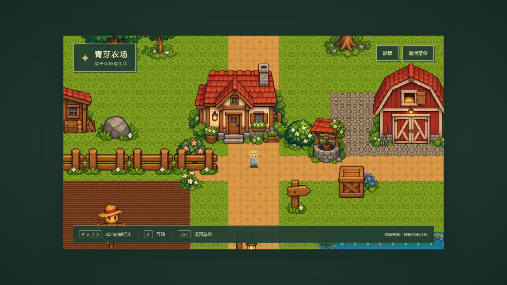
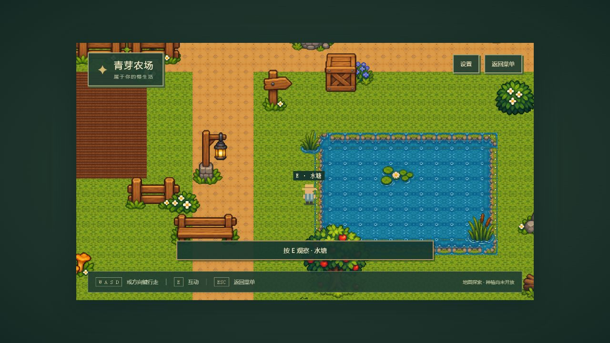

# 美术替换交付记录

日期：2026-10-12（Asia/Shanghai）。范围：按用户要求暂停后续玩法开发，用提供的五张 PNG 替换现有地图与菜单美术，保留已正常工作的玩家控制、场景与互动。

## 实施与已实现内容

1. 检查已有场景、Tiled 适配、GameState、碰撞、整数缩放与测试，继续使用现有架构。
2. 保存五张原始图集；裁切 51 个独立对象、30 个地形色块和 23 个水面/岸边色块。保留原图、原尺寸透明裁片和统一比例游戏副本。
3. 基础网格改为 32×32；60×40 地图世界为 1920×1280。建立 14 格本地 PNG 瓦片图集，地面通过原纹理镜像处理消除透明缝隙；岸边由原色块组合。
4. 菜单与农场使用原图的树木、建筑、道路、农田、池塘、栅栏、岩石和装饰。原来的地形、建筑、树木 Canvas 绘制已移除；保留现有玩家与菜单云朵占位。
5. 对象尺寸与素材 ID 数据驱动校验，树干、建筑地基、岩石、栅栏设置脚部碰撞；水面与岸边使用瓦片碰撞。地图生成器按相对范围计算碰撞，不在 Scene 硬编码大量坐标。
6. 保留物理速度移动、四方向动画、E 观察、相机平滑跟随与世界边界；相机显示位置略向上留出屋顶空间。

## 修改文件

- 规范与文档：AGENTS.md、README.md、.gitignore、docs/asset-sources.md、docs/map-contract.md、docs/art-upgrade-progress.md、docs/superpowers/plans/2026-10-10-pixel-farm-story.md。
- 素材处理与地图：scripts/import_art.py、scripts/generate-test-map.mjs、public/assets/art/source/、raw-crops/、objects/、terrain/、game/，以及 public/assets/maps/farm.json。逐对象来源与裁切尺寸见 src/data/art-manifest.json。
- 数据与转换：src/data/artAssets.ts、src/data/art-manifest.json、src/data/farmMap.ts、src/domain/grid.ts。
- 显示与加载：src/game/assets/generateTextures.ts、src/game/scenes/BootScene.ts、MenuScene.ts、FarmScene.ts、src/game/world/FarmMap.ts、src/style.css。
- 测试：tests/grid.test.ts、tests/farmMap.test.ts、tests/playerPhysics.test.ts、tests/mapRoutes.test.ts、tests/test_art_pipeline.py。
- 验收截图：docs/screenshots/art-crops.jpg、art-upgrade-menu.jpg、art-upgrade-farm.jpg、art-upgrade-pond.jpg；裁切检查辅助图 dock-region.png、cattails-region.png。

## 检查真实结果

| 检查 | 实际结果 | 退出状态 |
| --- | --- | --- |
| npm run typecheck | TypeScript strict 检查通过 | 0 |
| npm test | 7 个测试文件、32 项测试通过 | 0 |
| npm run build | Vite 生产构建成功 | 0 |
| Python tests/test_art_pipeline.py（Pillow / NumPy 环境） | 4 项素材处理测试通过 | 0 |

素材测试验证原图哈希、原始 RGBA 裁片、清理前后 RGB 不变、统一最近邻缩放、透明度与地面边缘拼接。游戏测试覆盖 32 格转换、非法素材 ID/尺寸、真实 Arcade Physics 障碍和边界，以及从出生点到农田、建筑、池塘和地图角落的路径可达性。

开发过程中先确认新格宽与地图契约测试失败，再实现对应改动。原物理测试的世界固定为旧 960×640，更新为实际 1920×1280 后验证新地图；保留原障碍断言，未跳过测试。独立审查发现码头、芦苇与相邻树冠裁片混入邻居边缘，现仅清理对应邻居透明度，并保存未经清理的裁片；复查通过。

浏览器实际操作：开发首页与新游戏正常；持续向房屋和水塘移动会被阻挡，反向移动能离开，E 显示观察文案；生产预览中验证沿池塘移动、相机跟随、设置开关面板、Esc 返回菜单与再次开始。1280×720 桌面窗口保持 960×540 居中显示，小于逻辑尺寸的窗口保留 1× 与滚动，没有画面拉伸。最终截图取自生产构建。

生产预览控制台 error/warn 捕获结果为空。开发验收初次复用旧浏览器标签时出现一次 Vite 热更新 WebSocket 连接错误（2026-10-12 16:20:34，已换算为东八区）；服务器就绪后刷新可以正常进入游戏，生产版本无此错误。构建仍提示 Phaser 分块超过 500 kB，输出约 1.48 MB；构建成功。

## 遗留与未实现

- 当前玩家、云朵仍为已有占位美术；没有绘制或生成新角色。后续缺少新图片先询问用户。
- 32 格地面来自高分辨率色块缩小与镜像，保留了完整原色块供后续调整；拼接可用，纹理存在重复。当前池塘采用矩形测试布局，未新增自然地形编辑系统。
- 建筑、鸡舍、谷仓等仍只可观察；种植、经营、NPC、存档与建筑内部尚未实现。
- 没有引入新的 npm 依赖。启动与构建直接使用本地 PNG；仅重新裁切素材时需要 Python、Pillow 和 NumPy。

## 运行

正常运行：npm run dev，打开 http://127.0.0.1:5173/，点击开始游戏。WASD / 方向键移动，E 观察，Esc 返回菜单。

重新处理素材：在含 Pillow / NumPy 的 Python 环境执行 scripts/import_art.py，再运行 node scripts/generate-test-map.mjs。后者覆盖现有 farm.json，手工修改地图前先另存。

