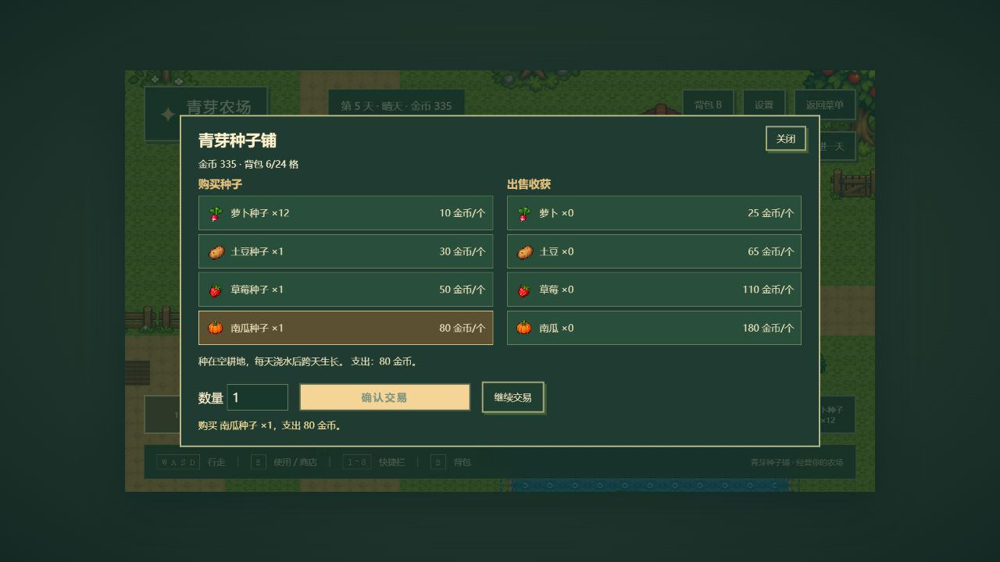

# 背包、快捷栏与基本经营交付

记录日期：2026-10-12（Asia/Shanghai）。按用户最新范围直接扩展现有工程，不引入新依赖或新绘制素材。

## 实现功能

- GameState 版本更新为 3：24 个实际背包格、8 个格子引用的快捷栏、当前栏位、背包修订号与下一交易编号。初始锄头、水壶、10 颗萝卜种子、500 金币保持不变。尚无存档适配器，未虚构版本迁移。
- 工具每格 1 件；同种、同品质种子与作物每格最多 99 件。添加先计算完整结果，容量不足不部分添加。点击查看说明、两格点击交换或拖动交换，同类合并到上限，显示数量与满包反馈。
- B 打开背包，1–8 选择实际栏位。拖动背包物品到快捷栏可绑定；拖动快捷栏可交换绑定，绑定空格即可空手收获。快捷栏不复制物品数量。
- 农田东北侧井旁木箱设为青芽种子铺，靠近按 E 打开，可买四种种子并卖四种收获。弹窗阻止世界输入，数量框可使用方向键调整。
- 交易先核对报价编号、背包修订、余额、合法数量、配置价格、金币与容量，再一起更新资源；同一报价不可重复成交。确认后按钮禁用，显式继续或重新选货准备下一交易。
- ItemDefinition 管理类别、说明、堆叠与价格；ShopDefinition 管理买卖列表及倍率。堆叠带品质字段，目前只有普通品质；折扣、其他品质和多店内容尚未制作，接口可扩展。

| 作物 | 种子价格 | 单个收获售价 | 有水生长日 |
| --- | ---: | ---: | ---: |
| 萝卜 | 10 | 25 | 4 |
| 土豆 | 30 | 65 | 6 |
| 草莓 | 50 | 110 | 8 |
| 南瓜 | 80 | 180 | 10 |

## 修改文件

- 新增 `src/data/items.ts`、`shops.ts`：类型化数据配置；修改 `crops.ts` 统一物品 ID 与种子价格来源。
- 新增 `src/domain/inventory.ts`、`economy.ts`；修改 `GameState.ts`、`farming.ts` 接入真实格子状态与原子物品操作。
- 新增 `src/game/ui/InventoryPanel.ts`、`ShopPanel.ts`、`itemDisplay.ts`；修改 `UIScene.ts`、`FarmScene.ts`、`src/style.css` 接入背包、交易、焦点与快捷栏。
- 修改 `scripts/generate-test-map.mjs`、`public/assets/maps/farm.json`，为现有木箱增加商店交互 ID。
- 新增 `tests/inventoryEconomy.test.ts`；修改 `tests/farming.test.ts` 保留有效断言并适配格子背包，对缺种子和缺工具增加装备失败断言。
- 更新 `README.md`、总体路线图、本记录；新增 `docs/screenshots/economy-backpack.jpg`、`economy-shop-sell.jpg`、`economy-loop.jpg` 浏览器证据。

## 真实验证

- `npm test`：退出码 0，10 文件、62 项通过。新增 11 项覆盖堆叠、容量、工具不堆叠、拖动规则、非法扣除、快捷栏、金币不足、购买出售、过期/重复报价、完整种植经营循环。首次新增测试在规则模块缺失时失败，实现后通过。
- `npm run typecheck`：退出码 0。
- `npm run build`：退出码 0。保留既有 Phaser 约 1.48 MB 大分块警告。
- 浏览器：真实拖动背包两格交换工具、点击绑定快捷栏 8、数字键切换通过；商店 E 打开，数量方向键 1→2，通过购买 2 颗萝卜种子，500→480 金币。
- 在第 1 天锄地、播种、浇水；逐天重新浇水并开发推进 4 天，第 5 天空手收获 1 个萝卜，种子 12→11。出售后金币 480→505、萝卜 1→0；再买四种种子各 1 颗，金币 505→335，背包 6/24 格。试买 999 颗南瓜种子显示金币不足，余额仍 335，背包不变。
- 此流程浏览器警告与错误日志为空。只读代码复核发现的数量输入键盘捕获问题已修复，并补全创建/退出时恢复捕获。
- 生产预览验证首页进入农场、B 打开 24 格背包及 8 格绑定；开发推进按钮不存在，浏览器警告与错误日志为空。

## 遗留问题

正式时间/天气、localStorage 存档、NPC 对话尚未实现；当前经营进度只存在内存，刷新或新游戏会重置。成长仍使用开发模式推进一天，生产构建不提供该入口。品质、折扣、多商店仅预留配置结构，没有对应玩法。工具图标沿用文字；种子/作物使用现有用户 PNG，不新增图片。

