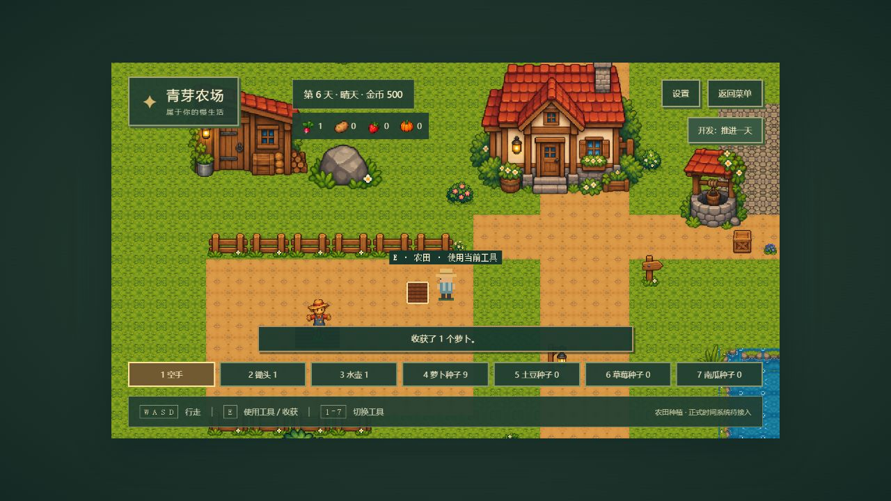

# 第三阶段交付：比例修正与农田种植

日期：2026-10-12（Asia/Shanghai）。种植闭环、四作物 PNG、工具栏与开发跨天已实现并验证；正式时间、天气生成、商店与存档未实现。

## 实施与状态

检查现有 GameState、Player、Tiled、FarmScene 和 UIScene 后继续现有架构。先修正装饰尺寸与碰撞，再先写测试实现纯 TypeScript 种植规则，最后接入输入、显示与浏览器验收。

- 玩家高 48px，稻草人改为 64px、围栏 40px、木门 44px、木箱 36px、水桶 28px。其他装饰按用途校准，建筑与树木维持原比例；围栏按新的 PNG 宽度衔接，南侧保留入口。原图与原尺寸裁片未修改。
- GameState 版本 2，保存 day、weather、coins、equipped、inventory、plots 和玩家位置。新游戏第 1 天、晴天、500 金币、锄头 1、水壶 1、萝卜种子 10。没有存档写入或旧存档迁移，存档系统尚未实现。
- 普通土地是 kind: natural，未改动地块默认普通；耕地是 kind: tilled，独立保存 wateredOn（日期/null）和 crop（实例/null）。作物保存 id、growthDays、plantedOn；成熟与阶段从配置计算，避免矛盾布尔状态。
- 可种植格来自 farmland 瓦片，排除碰撞瓦片及与物体碰撞区域相交的格子。普通地显示土路 PNG，开垦切换耕地 PNG，湿润为深色偏蓝 tint，前方目标格有边框。
- E 对前方相邻一格使用装备：锄地、播种、浇水；空手收获。已种地不能重复播种；检查成功后扣 1 颗种子。重复浇水不改变状态。背包满保留作物，收获成功后保留耕地与当天水分。
- 背包 24 格，同类每格 99，允许同类占多格。失败操作先校验再修改，不部分扣除或增加。
- advanceDay 带 expectedDay 防重复结算。只有当天浇水或降雨的未成熟作物推进 1 个生长日；次日水分清空，默认晴天。没有真实时间成熟或随机天气。
- 场景负责协调输入；farming 负责规则；FarmPlots 负责显示。日期、工具栏、金币、种子和产物均读取唯一 GameState。

## 作物参数与素材

本阶段参数可调整，不代表最终平衡。每株四阶段、一次收获 1 个产物，草莓本版不循环结果。

| 作物 | 有水生长日 | 阶段起始日 | 种子价格 |
| --- | --- | --- | --- |
| 萝卜 | 4 | 0、1、2、4 | 10 |
| 土豆 | 6 | 0、1、3、6 | 30 |
| 草莓 | 8 | 0、2、5、8 | 50 |
| 南瓜 | 10 | 0、2、6、10 | 80 |

初始只提供用户要求的萝卜种子，其他种子获取留待经营阶段；四种作物的规则和图片齐备，测试通过独立状态验证。种子价格仅为配置，未实现购买。

用户提供的“像素农作物生长与收获图鉴.png”完整保存在 public/assets/art/source/crops.png。scripts/import_crops.py 裁出 16 个生长阶段与 4 个收获产物；原尺寸 RGBA 裁片在 crops/，最近邻游戏副本在 game/crops/。同一作物行共用缩放比例，最大阶段宽不超过 30px、高不超过 40px，产物图标适配 24px；crop-art-manifest.json 记录哈希和裁切边界。没有绘制或生成新图片。

生长阶段按 growthDays 切换 PNG，成熟有金色提示，背包显示独立收获图标。玩家与云朵仍为现有占位素材。

## 操作

运行 npm run dev，打开 http://127.0.0.1:5173/，进入左侧农田。WASD / 方向键移动，E 使用面前一格，1 空手、2 锄头、3 水壶、4–7 四种种子，也可点击工具栏。

锄地 → 播种 → 浇水 → 点击“开发：推进一天” → 次日继续浇水；累计 4 个有水日后萝卜成熟，1 空手、E 收获。缺水可以跨天但不生长。推进按钮仅 Vite DEV 模式创建，FarmScene 同时检查 DEV，生产构建拒绝开发推进事件。

## 真实检查结果

| 检查 | 结果 | 退出状态 |
| --- | --- | --- |
| npm run typecheck | strict 检查通过 | 0 |
| npm test | 9 文件、51 测试通过 | 0 |
| npm run build | 32 模块，生产构建成功 | 0 |
| Python tests/test_art_pipeline.py（Pillow / NumPy 环境） | 5 项素材检查通过 | 0 |

测试覆盖初始资源、锄地、播种、重复播种、缺种子/工具、重复浇水、先浇后播、缺水、降雨、跨天去重、四作物阶段与成熟、生长封顶、收获、重复收获、背包满、非法区域、障碍格与前方坐标。已有物理、可达性、互动和整数缩放测试保留并通过。

先确认缺少种植模块时测试失败，再实现。测试曾把辅助函数装备锄头的变化误计为失败操作变更，调整为在快照前装备，保留整个状态比较断言。地图测试曾因 node:fs 类型缺失导致 typecheck 失败，沿用现有 JSON 静态导入修复，未加依赖。独立审查指出的类型阻塞已解决，复查通过。

浏览器实际完成：第 1 天播种并浇水，第 2 天生长；第 2 天不浇水跨至第 3 天，阶段保持；再经历 3 个有水日，第 6 天成熟。收获后萝卜 1、种子 9、金币 500，保留耕地。重复播种/收获均拒绝，道路不能锄地。开发与生产最终 error/warn 捕获为空，生产推进按钮数量 0。其他作物完整规则由单元测试验证，未将它们记为已做浏览器种植验收。

构建仍有既有 Phaser 分块超过 500 kB（约 1.48 MB）的提示，退出状态 0。

## 修改文件

- 比例与地图：scripts/import_art.py、scripts/generate-test-map.mjs、src/data/art-manifest.json、public/assets/art/game/objects/、public/assets/maps/farm.json。
- 新作物素材：scripts/import_crops.py、src/data/cropArt.ts、src/data/crop-art-manifest.json、public/assets/art/source/crops.png、public/assets/art/crops/、public/assets/art/game/crops/。
- 数据与规则：src/data/crops.ts、src/domain/GameState.ts、src/domain/farming.ts。
- 场景与显示：src/game/scenes/BootScene.ts、FarmScene.ts、UIScene.ts、src/game/world/FarmPlots.ts、farmingArea.ts、src/style.css。
- 测试：tests/farming.test.ts、tests/farmingArea.test.ts、tests/test_art_pipeline.py。
- 文档：README.md、docs/map-contract.md、docs/asset-sources.md、docs/phase-3-progress.md、docs/superpowers/plans/2026-10-10-pixel-farm-story.md。
- 截图：docs/screenshots/crop-cuts.jpg、phase-3-watered.jpg、phase-3-dry-day.jpg、phase-3-mature.jpg、phase-3-harvest.jpg、phase-3-production.jpg。

## 遗留问题

正式时间、天气生成、商店/其他种子获取与存档未实现。刷新或新游戏重置内存状态。后续缺少新图片时先询问用户。

