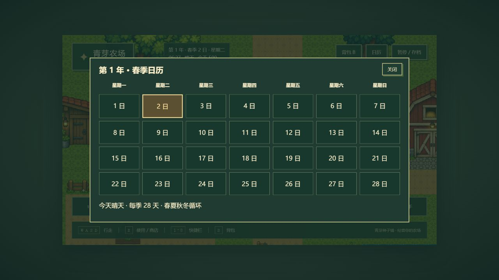

# 第五阶段：时间、天气、日历与存档

交付日期：2026-10-12（Asia/Shanghai）。实施方案见 `superpowers/plans/2026-10-12-time-save.md`。保持现有 PNG、地图、种植与经营功能，不新增依赖。

## 实现功能

- 新游戏为第 1 年春季 1 日星期一 06:00。每季 28 天，春夏秋冬循环；星期与年份由总日数派生。UI 显示完整日期、时钟、天气、金币；日历有 7×4 日期与当天高亮。
- 750 毫秒现实时间对应 1 分钟游戏时间，06:00–次日 02:00 的 1200 分钟对应 15 分钟。02:00 自动跨天至 06:00；小屋门前 E 打开休息面板，可直接睡到次日。弹窗、Esc 暂停和后台页面停表，不计算离线成长。
- 晴天、阴天、雨天按配置与存档中的随机种子生成。雨天自动保持露天可耕地湿润，夜色、阴雨遮罩和雨线只作用于世界，DOM UI 保持亮度。
- `time.advanceDay` 为跨天入口，核对预期日及 `lastSettledDay`，再结算当天水分、作物、日数、时钟和天气。种植模块只执行结算步骤；睡觉和 02:00 共用入口，成功后自动保存。
- `schemaVersion: 4` 的 JSON 单槽存档保存位置、金币、24 格背包/8 格绑定、日期时钟、天气种子、地块及作物进度、结算日和交易防重状态。首页“继续游戏”、暂停面板“保存游戏”和“读取存档”均可操作。
- 字段校验拒绝损坏 JSON、缺字段、不兼容版本、负金币、非法物品/数量/品质、错误日期或坐标、非法作物与天气类型。应用层校验地图碰撞及可耕区。覆盖前同样验证旧档；不兼容或损坏旧档保留原文本。localStorage 拒读/拒写会显示错误，保留内存进度。

## 修改文件

- 新增 `src/data/timeConfig.ts`、`src/domain/time.ts`；修改 `GameState.ts`、`farming.ts`，升级可保存状态并统一跨天。
- 新增 `src/adapters/storage/saveCodec.ts`、`SaveRepository.ts`、`src/application/session.ts`，分别负责 JSON 校验、存储读写和地图恢复校验。
- 新增 `src/game/world/WorldAtmosphere.ts`、`lighting.ts`；修改 `FarmScene.ts`、`MenuScene.ts`、`UIScene.ts`、`entities/Player.ts`、`src/style.css`，接入时钟、天气、睡觉、暂停、日历和存档菜单。
- 修改 `scripts/generate-test-map.mjs`、`public/assets/maps/farm.json`，保留小屋碰撞并启用门前睡觉互动。
- 新增 `tests/timeSave.test.ts`（15 项）、`tests/lighting.test.ts`（1 项）；原有 62 项保留。
- 更新 README、总体路线图与本记录；新增实施方案，以及 `phase-5-calendar.jpg`、`phase-5-restored-farm.jpg`、`phase-5-cloudy.jpg`、`phase-5-rain.jpg` 浏览器截图。

## 实际检查结果

| 命令 | 退出码 | 结果 |
| --- | ---: | --- |
| `npm test` | 0 | 12 文件，78 项通过 |
| `npm run typecheck` | 0 | TypeScript strict 检查通过 |
| `npm run build` | 0 | 生产构建完成；保留 Phaser 约 1.48 MB 大分块警告 |

测试覆盖 15 分钟对应一日及超出时间、暂停、季节/年份/星期边界、睡觉和自动跨天的单次生长、雨天湿润、天气重载确定性、完整状态 JSON 往返、缺失/错误字段、保存容量拒写、旧档保护及地图位置校验；夜间与天气光照强度也有断言。

新增模块测试最初因模块不存在失败；审查发现的天气数组与地图不兼容旧档覆盖问题分别经过失败回归测试后修复。最终只读复核没有新的 P1/P2。

## 浏览器验收

1. 新游戏显示春季 1 日星期一、06:00，时钟随游戏运行推进。暂停前后 HUD 都为春季 2 日 07:08，期间未变化。
2. 种植萝卜并浇水，种子 10→9；走回小屋 E 睡觉，进入春季 2 日 06:00，提示自动保存成功。
3. 关闭游戏页面后新开同来源页面，首页可继续春季 2 日；恢复种子 9 颗、位置及农田，萝卜显示第 2 生长阶段。手动读取也恢复保存时进度。
4. 日历显示 28 天，第二天高亮；继续小屋睡觉，春季 4 日显示阴天，8 日显示雨天。雨线、湿润农田和较暗世界可见，UI 清晰。夜间强度由单元测试验证，未在浏览器等待完整 15 分钟。
5. 生产预览手动保存成功，刷新后“继续游戏”可用；开发跨天按钮已删除。浏览器流程未发现错误或警告日志。

## 限制与遗留

- 首版仅一个存档槽；不提供旧 schema 迁移、云同步、导入导出或损坏存档删除按钮。
- 自动保存仅在次日开始时执行，当前日内新进度需手动保存。新游戏不会立即覆盖旧档；之后保存可覆盖通过校验的同版本旧档。
- 存档按浏览器来源隔离，不同端口各自独立；清理浏览器站点数据会移除存档。
- 小屋内部地图、NPC 对话、季节作物限制和天气音效尚未实现。原有作物暂不因季节枯萎；雨天视觉使用几何效果，不重新绘制用户 PNG。

